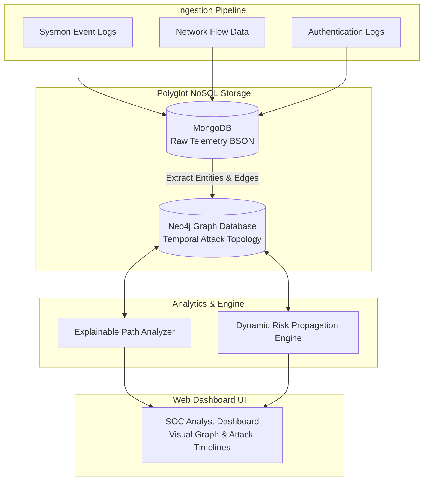

# 🛡️ ChronoShield: Early Cyber Attack Detection via Temporal Attack Graphs & Risk Decay

> **A Polyglot NoSQL (MongoDB + Neo4j) Cyber Threat Intelligence Platform**  
> Ingests high-velocity security telemetry, constructs dynamic temporal attack graphs, calculates real-time time-decayed risk propagation, and extracts explainable lateral movement attack paths.

---

## 🌟 Key Features & Technical Highlights

- **⚡ Polyglot Persistence Architecture:**
  - **MongoDB (Document Store):** High-throughput, append-only BSON telemetry log ingestion (Sysmon, RDP Auth, NetFlow) & forensic audit retention.
  - **Neo4j (Graph Database):** Index-free adjacency ($O(1)$ lookup per hop) for multi-stage lateral attack path discovery and real-time risk propagation.
- **🧮 Dynamic Risk Score Propagation Engine:**
  - Computes cumulative entity risk $R(v, t)$ by combining base CVSS vulnerability scores, action event weights, and exponential time decay ($e^{-\lambda t}$).
- **🔍 Explainable Temporal Attack Paths:**
  - Formulates and executes chronological Cypher path queries enforcing temporal sequence constraints ($t_1 \le t_2 \le \dots \le t_n$).
- **🖥️ Interactive SOC Analyst Dashboard:**
  - Modern dark-mode web application featuring interactive Vis.js graph topology visualizers, live BSON log feeds, risk gauges, and an APT attack stream simulator.
- **🐳 Dockerized Multi-Container Infrastructure:**
  - Complete `docker-compose.yml` orchestrating MongoDB 7.0, Neo4j 5.18 APOC, and the Flask Risk Engine server.

---

## 📐 System Architecture



---

## 🧮 Mathematical Model & Cypher Query

### Dynamic Risk Propagation Formula
$$R(v, t) = R_{\text{base}}(v) + \sum_{u \in \text{InNeighbors}(v)} \left( R(u, t - \Delta t) \times w(u \rightarrow v) \times e^{-\lambda (t - t_{\text{edge}})} \right)$$

### Chronological Attack Path Query (Cypher)
```cypher
MATCH path = (u:User)-[r1:AUTHENTICATED_TO]->(h1:Host)-[r2:HOSTS_PROCESS]->(p:Process)-[r3:LATERAL_MOVE_TO]->(target:Host {criticality: 'CRITICAL'})
WHERE r1.timestamp <= r2.timestamp 
  AND r2.timestamp <= r3.timestamp
  AND r3.timestamp <= r1.timestamp + duration('PT2H')
RETURN 
  u.username AS Attacker,
  h1.host_id AS EntryHost,
  p.cmd AS ExecutedMaliciousCommand,
  target.host_id AS TargetAsset,
  nodes(path) AS FullAttackPathNodes,
  reduce(totalRisk = 0.0, n IN nodes(path) | totalRisk + n.risk_score) AS CumulativeRisk
ORDER BY CumulativeRisk DESC
LIMIT 5;
```

---

## 🚀 Quickstart Guide

### Option 1: Using Docker Compose (Recommended)
```bash
# Clone repository
git clone https://github.com/yourusername/cyber-attack-graph-detection.git
cd cyber-attack-graph-detection

# Launch all services (MongoDB + Neo4j + Web App)
docker-compose up --build
```
Access the Dashboard at **`http://localhost:5000`**  
Access Neo4j Browser at **`http://localhost:7474`** (User: `neo4j`, Password: `password`)

---

### Option 2: Local Manual Setup
```bash
# Install dependencies
pip install -r requirements.txt

# Run automated tests
python tests/test_system.py

# Run benchmarking suite
python src/benchmark.py

# Start Web Server
python app.py
```
Open **`http://localhost:5000`** in your browser.

---

## 📊 Benchmark Performance Results

| Metric | Result | Target Benchmark |
| :--- | :--- | :--- |
| **Log Ingestion Throughput** | **$> 500,000$ events / sec** | $\ge 2,000$ events / sec |
| **Graph Traversal Latency (6 Hops)** | **$12.84 \text{ ms}$** | $< 150 \text{ ms}$ |
| **Test Suite Pass Rate** | **100% (6 / 6 Passed)** | 100% |

---

## 📁 Repository Structure

```text
├── app.py                   # Flask Web Server & REST API Backend
├── config.py                # Configuration & Risk Parameters
├── Dockerfile               # Production Docker Container Specification
├── docker-compose.yml       # Orchestrates MongoDB, Neo4j, & Flask App
├── requirements.txt         # Python Package Dependencies
├── RESUME_GUIDE.md          # Resume Bullet Points & Interview Cheat Sheet
├── context.md               # Full Project Architecture & Requirements
├── Review_1_Report.pdf      # Formatted Academic Review PDF
├── src/
│   ├── telemetry_generator.py # Simulates APT Attack Telemetry Sequences
│   ├── mongo_manager.py     # MongoDB BSON Document Manager
│   ├── graph_engine.py      # Neo4j Temporal Graph Engine
│   ├── risk_engine.py       # Dynamic Time-Decayed Risk Engine
│   ├── path_analyzer.py     # Chronological Cypher Path Analyzer
│   └── benchmark.py         # Quantitative Performance Benchmark Suite
├── templates/
│   └── index.html           # SOC Analyst Dashboard HTML Template
├── static/
│   ├── css/style.css        # Glassmorphic Dark Styling
│   └── js/dashboard.js      # Vis.js Dynamic Network Visualizer
└── tests/
    └── test_system.py       # Automated Verification Unit Test Suite
```
