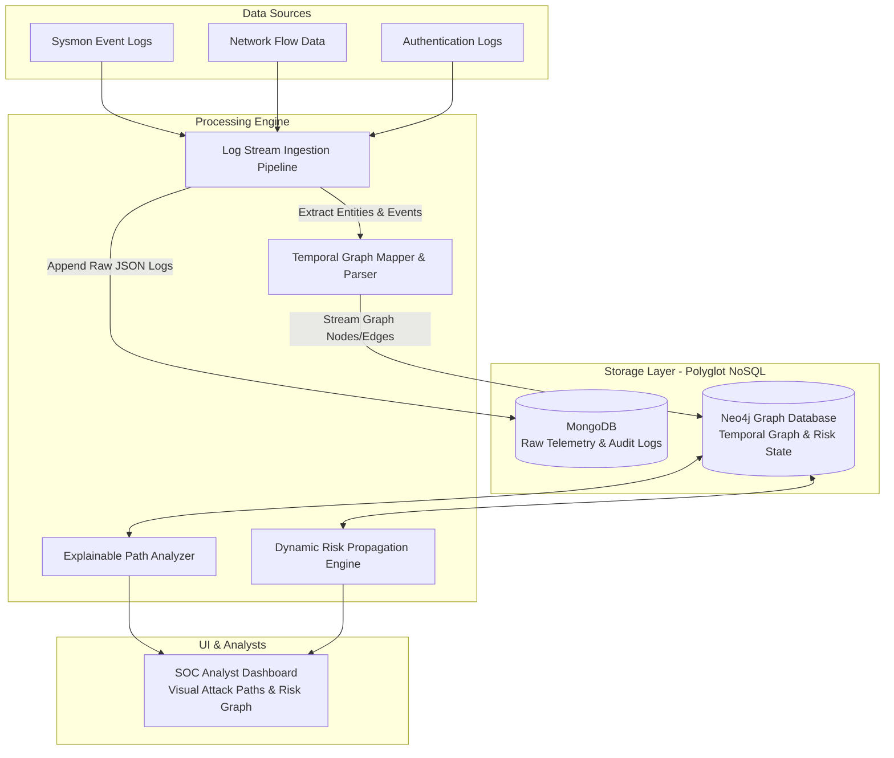
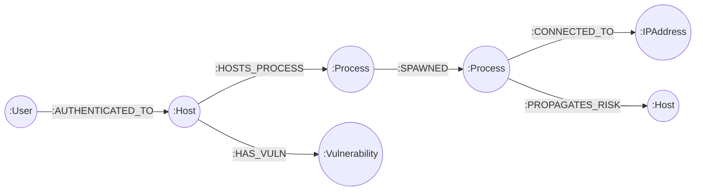

# Dynamic Early Cyber Attack Detection using Temporal Graph + Risk Propagation + Explainable Attack Paths

> **Project Context, Requirement Analysis & NoSQL Database Architecture Document**  
> **Course / Field:** Database Management Systems (NoSQL Architecture) & Cyber Security  
> **Databases Chosen:** **MongoDB** (Temporal Document Telemetry) + **Neo4j** (Dynamic Attack Graph & Risk Propagation Engine)

---

## 1. Executive Summary & Problem Definition

### 1.1 Background & Problem Statement
Modern Advanced Persistent Threats (APTs) and multi-stage cyber attacks rarely trigger isolated, high-severity alarms. Instead, stealthy attackers execute low-and-slow tactics (e.g., living-off-the-land techniques, credential dumping, lateral movement, privilege escalation) across prolonged time windows. 

Traditional Intrusion Detection Systems (IDS) and relational Security Information and Event Management (SIEM) tools suffer from two major limitations:
1. **Stateless / Isolated Log Analysis:** They analyze individual events or fixed log correlations, missing complex multi-hop temporal causal chains across systems.
2. **Relational Join Bottlenecks:** Querying multi-hop connections (e.g., User $A \rightarrow$ Host $B \rightarrow$ Process $C \rightarrow$ Network Socket $D \rightarrow$ Host $E$) requires complex SQL multi-table `JOIN` operations that degrade exponentially in performance as path depth increases.

### 1.2 Objectives
The primary objective of this project is to build a **Hybrid NoSQL Framework** combining **MongoDB** and **Neo4j** to enable:
1. **High-Throughput Ingestion:** Store high-velocity, semi-structured system and network telemetry logs in **MongoDB** with rich temporal metadata.
2. **Dynamic Temporal Graph Modeling:** Map event streams into a dynamic temporal graph structure in **Neo4j** where nodes represent cyber entities (Users, Hosts, Processes, IPs, Vulnerabilities) and edges represent time-stamped actions.
3. **Dynamic Risk Propagation:** Compute real-time risk scores across graph entities based on vulnerability severity (CVSS), anomalous behavior, and temporal decay.
4. **Explainable Attack Path Generation:** Automatically isolate and explain full attack paths leading to critical assets before data exfiltration or ransomware deployment occurs.

### 1.3 System Scope
- **Ingestion Scope:** Windows Sysmon event logs, Linux Auditd, Network Flow (NetFlow/IPFIX), and Authentication logs (Active Directory/Kerberos).
- **Storage Scope:** MongoDB stores historical raw logs and structured audit documents. Neo4j maintains the active topological temporal graph.
- **Analytics Scope:** Real-time temporal edge creation, continuous risk score propagation, multi-hop shortest path analysis, and SOC analyst threat explanation.

---

## 2. System Architecture & Polyglot NoSQL Justification



### 2.1 Why Polyglot NoSQL (MongoDB + Neo4j)?

| Feature / Criteria | Relational DB (PostgreSQL / MySQL) | Document Store (MongoDB) | Graph DB (Neo4j) | **Our Hybrid Solution (MongoDB + Neo4j)** |
| :--- | :--- | :--- | :--- | :--- |
| **High-Velocity Log Ingestion** | Poor (Schema lock, row overhead) | **Excellent** (Append-only JSON documents) | Moderate (Better at relationship indexing) | **MongoDB handles raw log ingestion** |
| **Flexible Unstructured Logs** | Low (Requires strict migrations) | **High** (Schema-less BSON documents) | Moderate | **MongoDB accommodates varied log schemas** |
| **Multi-Hop Traversal Performance** | Exponential decay ($O(k^d)$ join operations) | Poor (Requires application-side joins) | **Optimal** (Index-free adjacency $O(1)$ per hop) | **Neo4j traverses multi-stage attack paths** |
| **Risk Score Graph Propagation** | Highly complex SQL CTEs | Inefficient map-reduce | **Native Cypher / Graph Algorithms** | **Neo4j propagates risk natively** |

#### Justification for MongoDB:
- **Write-Heavy Ingestion:** Security telemetry produces thousands of events per second. MongoDB’s document store allows fast, non-blocking inserts of diverse log formats (Sysmon Event ID 1, Event ID 3, Auth Event 4624) without pre-defining rigid table structures.
- **Auditability & Deep Inspection:** Full payload details (e.g., command-line strings, HTTP headers, hash signatures) are retained in MongoDB for forensic deep-dives without cluttering the graph database.

#### Justification for Neo4j:
- **Index-Free Adjacency:** Neo4j stores node pointers directly, enabling traversal across $N$-hop relationships in constant time relative to total graph size.
- **Temporal Edge Support:** Allows modeling relationships with attributes (`timestamp`, `session_id`, `duration`) to detect temporal sequences (e.g., Event $A$ occurred strictly *before* Event $B$ within a 5-minute window).
- **Native Graph Algorithms:** Supports PageRank-style risk propagation, shortest weighted path algorithms, and community detection natively.

---

## 3. Data Model Design & Schemas

### 3.1 ER-to-NoSQL Mapping Strategy

```
Relational Entity          =>   MongoDB Document Collection        =>   Neo4j Node / Relationship
-----------------               ---------------------------             --------------------------
Host (Asset)               =>   db.assets (Collection)              =>   (:Host {host_id, hostname, ip, risk_score})
User (Account)             =>   db.users (Collection)               =>   (:User {user_id, username, role})
Process                    =>   db.raw_telemetry (embedded object)  =>   (:Process {pid, process_name, hash})
IP Address / Endpoint      =>   db.raw_telemetry (embedded object)  =>   (:IPAddress {ip, geolocation, threat_intel_score})
Vulnerability (CVE)        =>   db.vulnerabilities (Collection)     =>   (:Vulnerability {cve_id, cvss_score})

Relational Foreign Key     =>   MongoDB Array / Embedded Doc        =>   Neo4j Directed Labeled Edge
----------------------          ----------------------------             ---------------------------
User -> Host Auth          =>   { user_id, target_host_id }         =>   (:User)-[:AUTHENTICATED_TO {timestamp}]->(:Host)
Process -> Network         =>   { pid, dst_ip, port }               =>   (:Process)-[:CONNECTED_TO {timestamp, port}]->(:IPAddress)
Process -> Process         =>   { parent_pid, child_pid }           =>   (:Process)-[:SPAWNED {timestamp}]->(:Process)
Host -> Vulnerability      =>   { host_id, cve_list: [] }           =>   (:Host)-[:HAS_VULNERABILITY]->(:Vulnerability)
```

---

### 3.2 MongoDB Collection Schemas

#### 1. Collection: `raw_telemetry`
Stores full, un-truncated temporal telemetry logs ingested from agent endpoints.

```json
{
  "_id": { "$oid": "66c7f1a8e4b0a123456789ab" },
  "event_id": "SYS-001928",
  "timestamp": { "$date": "2026-08-22T14:32:10.000Z" },
  "log_source": "Sysmon",
  "event_type": "ProcessCreation",
  "host": {
    "host_id": "HOST-FIN-01",
    "hostname": "fin-workstation-01.corp.internal",
    "ip": "10.0.4.15"
  },
  "user": {
    "username": "jsmith",
    "domain": "CORP"
  },
  "process": {
    "pid": 4120,
    "process_name": "cmd.exe",
    "command_line": "cmd.exe /c powershell.exe -ExecutionPolicy Bypass -enc SQBFAFgA...",
    "parent_pid": 1044,
    "parent_process_name": "explorer.exe",
    "hash_sha256": "e3b0c44298fc1c149afbf4c8996fb92427ae41e4649b934ca495991b7852b855"
  },
  "network": {
    "destination_ip": "194.26.29.112",
    "destination_port": 443,
    "protocol": "TCP"
  },
  "severity": "MEDIUM",
  "ingested_at": { "$date": "2026-08-22T14:32:11.120Z" }
}
```

#### 2. Collection: `asset_inventory`
Stores static and dynamic information about high-value assets and host criticality.

```json
{
  "_id": "HOST-FIN-01",
  "hostname": "fin-workstation-01.corp.internal",
  "criticality_tier": "HIGH",
  "business_unit": "Finance",
  "installed_os": "Windows Server 2022",
  "vulnerabilities": [
    { "cve_id": "CVE-2024-30078", "cvss_score": 8.8, "patched": false },
    { "cve_id": "CVE-2023-21768", "cvss_score": 7.8, "patched": true }
  ],
  "base_risk_score": 15.0,
  "last_assessed": { "$date": "2026-08-22T00:00:00.000Z" }
}
```

---

### 3.3 Neo4j Graph Schema Design



#### Node Labels & Properties:
- **`(:Host)`**: `{host_id: String, hostname: String, ip: String, criticality: String, risk_score: Float}`
- **`(:User)`**: `{username: String, domain: String, is_privileged: Boolean, risk_score: Float}`
- **`(:Process)`**: `{pid: Integer, name: String, cmd: String, hash: String, risk_score: Float}`
- **`(:IPAddress)`**: `{ip: String, is_external: Boolean, threat_score: Float}`
- **`(:Vulnerability)`**: `{cve_id: String, cvss: Float}`

#### Relationship Types & Properties:
- **`(:User)-[:AUTHENTICATED_TO {timestamp: Datetime, auth_type: String, status: String}]->(:Host)`**
- **`(:Process)-[:SPAWNED {timestamp: Datetime}]->(:Process)`**
- **`(:Process)-[:CONNECTED_TO {timestamp: Datetime, port: Integer, bytes: Integer}]->(:IPAddress)`**
- **`(:Host)-[:HAS_VULNERABILITY]->(:Vulnerability)`**
- **`(:Host)-[:TRANSFERS_DATA_TO {timestamp: Datetime, volume_mb: Float}]->(:Host)`**
- **`(:Process)-[:PROPAGATES_RISK {delta: Float, timestamp: Datetime}]->(:Host)`**

---

## 4. Temporal Graph Logic & Dynamic Risk Propagation Algorithm

### 4.1 Temporal Edge Validity
In cyber attack graphs, an edge $E_1$ can only cause edge $E_2$ if:
$$\text{Timestamp}(E_1) \le \text{Timestamp}(E_2) \le \text{Timestamp}(E_1) + \Delta t$$
Where $\Delta t$ is the maximum temporal attack correlation window (e.g., 2 hours). Edges older than $\Delta t$ decay in risk weight.

### 4.2 Dynamic Risk Propagation Equation
The cumulative risk score $R(v)$ for any node $v$ at time $t$ is calculated dynamically as:

$$R(v, t) = R_{\text{base}}(v) + \sum_{u \in \text{InNeighbors}(v)} \left( R(u, t - \Delta t) \times w(u \rightarrow v) \times e^{-\lambda (t - t_{\text{edge}})} \right)$$

Where:
- $R_{\text{base}}(v)$: Base intrinsic vulnerability risk (CVSS score or asset criticality).
- $w(u \rightarrow v)$: Edge transition probability / weight based on action risk (e.g., process spawning encoded PowerShell = 0.95; standard SSH auth = 0.20).
- $e^{-\lambda (t - t_{\text{edge}})}$: Exponential temporal decay factor ($\lambda$ is the time decay rate).

---

## 5. Requirement Specification

### 5.1 Functional Requirements (FR)
- **FR-01 (Multi-Source Log Ingestion):** The system shall ingest raw security logs into MongoDB `raw_telemetry` collection with structured metadata validation.
- **FR-02 (Graph Topology Extraction):** The system shall parse MongoDB documents into entity nodes and temporal directed edges in Neo4j in near-real-time (< 2 seconds).
- **FR-03 (Temporal Edge Filtering):** The system shall filter attack paths enforcing chronological constraints ($t_1 \le t_2 \le \dots \le t_n$).
- **FR-04 (Dynamic Risk Calculation):** The system shall update entity risk scores in Neo4j whenever a new anomalous edge is created or a high CVSS vulnerability is associated with a host.
- **FR-05 (Explainable Attack Path Querying):** The system shall expose a Cypher interface that returns the highest cumulative risk path from an untrusted entry node to any high-criticality host asset.
- **FR-06 (Alert Generation):** The system shall generate an alert in MongoDB `alerts` collection when an asset's propagated risk exceeds a threshold (e.g., $R(v) > 75.0$).

### 5.2 Non-Functional Requirements (NFR)
- **NFR-01 (Ingestion Scalability):** Ingestion into MongoDB must support sustained write loads of $\ge 2,000$ events/second.
- **NFR-02 (Graph Query Latency):** Multi-hop (up to 6 hops) attack path extraction in Neo4j must complete in under $150 \text{ ms}$.
- **NFR-03 (Data Retention & Archival):** MongoDB raw logs shall be index-partitioned by month for efficient TTL deletion or warm storage archiving.
- **NFR-04 (Explainability):** Every alert must include a human-readable node-by-node path visual breakdown (e.g., `User(attacker) -> Auth -> Host(Jumpbox) -> Process(mimikatz) -> Host(DomainController)`).

---

## 6. Sample Dataset & Demonstration Code

### 6.1 Sample Data Ingestion into MongoDB
```javascript
// MongoDB Insert: Raw Telemetry Event (Ingestion Stage)
db.raw_telemetry.insertMany([
  {
    "event_id": "EVT-9001",
    "timestamp": ISODate("2026-08-22T15:00:00Z"),
    "event_type": "AUTHENTICATION",
    "source_user": "admin_temp",
    "target_host": "HOST-JUMPBOX-01",
    "src_ip": "198.51.100.44",
    "status": "SUCCESS"
  },
  {
    "event_id": "EVT-9002",
    "timestamp": ISODate("2026-08-22T15:05:00Z"),
    "event_type": "PROCESS_SPAWN",
    "host": "HOST-JUMPBOX-01",
    "parent_process": "services.exe",
    "child_process": "powershell.exe",
    "command_line": "powershell -ep bypass -c Invoke-Mimikatz"
  },
  {
    "event_id": "EVT-9003",
    "timestamp": ISODate("2026-08-22T15:12:00Z"),
    "event_type": "NETWORK_LATERAL_MOVE",
    "source_host": "HOST-JUMPBOX-01",
    "target_host": "HOST-DB-PROD-01",
    "target_port": 445,
    "user": "NT AUTHORITY\\SYSTEM"
  }
]);
```

### 6.2 Neo4j Graph Initialization & Temporal Ingestion (Cypher)
```cypher
// 1. Create Constraints & Indexes
CREATE CONSTRAINT FOR (h:Host) REQUIRE h.host_id IS UNIQUE;
CREATE CONSTRAINT FOR (u:User) REQUIRE u.username IS UNIQUE;
CREATE CONSTRAINT FOR (p:Process) REQUIRE p.pid_hash IS UNIQUE;
CREATE INDEX FOR ()-[r:AUTHENTICATED_TO]-() ON (r.timestamp);

// 2. Insert Nodes & Relationships from Telemetry Stream
// Node Creation
MERGE (u:User {username: 'admin_temp'}) ON CREATE SET u.risk_score = 40.0
MERGE (h1:Host {host_id: 'HOST-JUMPBOX-01'}) ON CREATE SET h1.risk_score = 20.0, h1.criticality = 'MEDIUM'
MERGE (h2:Host {host_id: 'HOST-DB-PROD-01'}) ON CREATE SET h2.risk_score = 10.0, h2.criticality = 'CRITICAL'

MERGE (p1:Process {pid_hash: 'HOST-JUMPBOX-01_powershell_9002'}) 
  ON CREATE SET p1.name = 'powershell.exe', p1.cmd = 'Invoke-Mimikatz', p1.risk_score = 85.0

// Temporal Relationship Edges
MERGE (u)-[r1:AUTHENTICATED_TO {timestamp: datetime('2026-08-22T15:00:00Z'), src_ip: '198.51.100.44'}]->(h1)
MERGE (h1)-[r2:HOSTS_PROCESS {timestamp: datetime('2026-08-22T15:05:00Z')}]->(p1)
MERGE (p1)-[r3:LATERAL_MOVE_TO {timestamp: datetime('2026-08-22T15:12:00Z'), port: 445}]->(h2);
```

### 6.3 Explainable Attack Path Cypher Query
Finds the chronologically valid attack paths starting from external/high-risk accounts leading to high-criticality assets (`CRITICAL`), computing total cumulative risk.

```cypher
// Query: Extract Explainable Temporal Attack Path
MATCH path = (u:User)-[r1:AUTHENTICATED_TO]->(h1:Host)-[r2:HOSTS_PROCESS]->(p:Process)-[r3:LATERAL_MOVE_TO]->(target:Host {criticality: 'CRITICAL'})
WHERE r1.timestamp <= r2.timestamp 
  AND r2.timestamp <= r3.timestamp
  AND r3.timestamp <= r1.timestamp + duration('PT2H')
RETURN 
  u.username AS InitialActor,
  h1.host_id AS CompromisedEntryHost,
  p.cmd AS ExecutedMaliciousCommand,
  target.host_id AS TargetCriticalAsset,
  nodes(path) AS FullAttackPathNodes,
  relationships(path) AS TemporalEdges,
  reduce(totalRisk = 0.0, n IN nodes(path) | totalRisk + n.risk_score) AS CumulativePathRiskScore
ORDER BY CumulativePathRiskScore DESC
LIMIT 5;
```

---

## 7. Summary of Deliverables Alignment

| Assignment Deliverable Requirement | Location in this Document | Implementation Details |
| :--- | :--- | :--- |
| **Problem Statement, Objectives & Scope** | Section 1 | Clear definition of limitations of static SIEMs vs multi-hop attack graphs. |
| **Selection & Justification of NoSQL Database** | Section 2 | Polyglot justification: MongoDB for high-velocity raw log ingestion + Neo4j for index-free graph traversal. |
| **Data Model Design (Collections / Graph Schema)** | Section 3 | Full JSON schema for MongoDB collections & Cypher schema for Neo4j nodes/relationships with properties. |
| **ER-to-NoSQL Mapping Strategy** | Section 3.1 | Tabular mapping from relational tables to NoSQL collections & graph elements. |
| **Requirement Specification** | Section 5 | Detailed Functional (FR-01 to FR-06) and Non-Functional Requirements (NFR-01 to NFR-04). |
| **Sample Dataset & Queries** | Section 6 | Executable MongoDB JSON documents, Neo4j graph creation, and Cypher temporal path detection query. |

